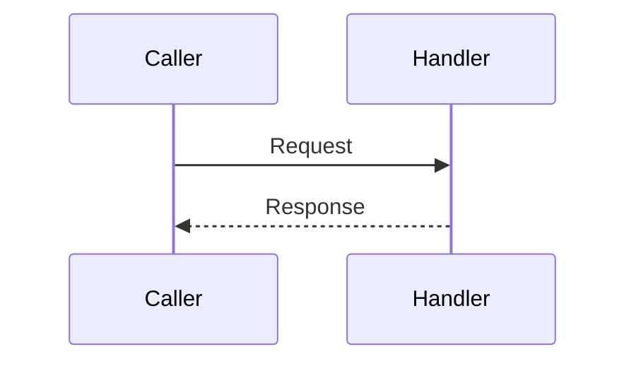

# <Flow name>

Status: template; no implemented flow.

## Business purpose
## API endpoint or triggering event
## Request and response
Include schemas and examples.

## Ordered function call flow
List all significant calls in execution order.

## Functions and responsibilities
For each significant function: source reference, purpose, parameters, return values.

## Business rules and validation
## Database queries and transactions
## Error handling and edge cases
## Concurrency and consistency
## Sequence diagram
Replace this illustrative diagram with actual participants and calls.

## Source-file references
## Tests validating the flow
Record exact commands and observed results; distinguish planned tests.
