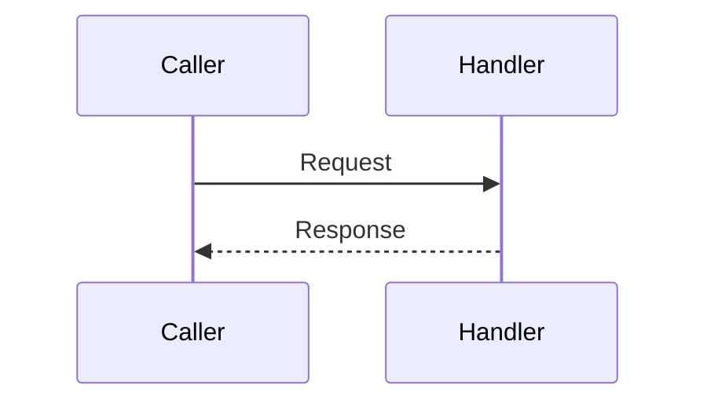

# <Flow name>

Status: template; no implemented flow.

Write for a developer who has never seen CourtFlow. Keep Chisle off throughout.
Verify every statement against source, SQL and tests. Explain the reason for each
important rule and distinguish implemented behavior, observed test results and
future work. Do not copy unrelated endpoint rules into each document. Use the
headings below and add flow-specific sections when needed.

## Business purpose
## API endpoint or triggering event
## Request and response
Include schemas and examples.

## Ordered function call flow
Use a numbered walkthrough from the caller through routing/middleware, validation,
helpers and actual SQL, then back to the response/UI. Name files and functions.
Do not invent a service or repository layer if handlers call pgx directly.

## Functions and responsibilities
For each significant function, identify source, purpose, parameter meaning/units,
return values and errors. Explain shared helpers within the parent flow.

## Business rules and validation
## Database queries and transactions
## Error handling and edge cases
## Concurrency and consistency
## Sequence diagram
Replace this illustrative diagram with actual participants and calls.

## Source-file references
## Tests validating the flow
Record exact local commands, test names and what their assertions actually prove.
Distinguish real PostgreSQL from HTTP mocks, previous receipts from fresh runs, and
missing coverage from tested behavior. Never infer an assertion from a test name.

## Limitations and follow-up

Describe relevant limitations and recovery actions in complete sentences. A diagram
summarizes the prose; it does not replace transaction, error or concurrency details.
