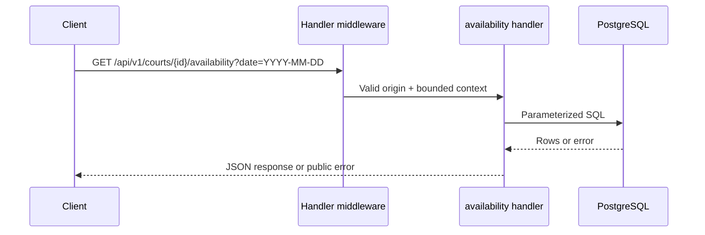

# Availability flow

## Business purpose
Present one-hour sessions in the venue timezone with current occupancy and server prices.

## API endpoint or triggering event
`GET /api/v1/courts/{id}/availability?date=YYYY-MM-DD`. Public fictional demo; no authentication or private user records.

## Request and response
Positive court ID and local calendar date. Returns array of `{start_at,end_at,available,price_sen}`. Instants are serialized in UTC; the client formats MYT.

```bash
curl "http://localhost:8080/api/v1/courts/1/availability?date=YYYY-MM-DD"
```

## Complete ordered function call flow
1. `cmd/server/main.go:main` creates a bounded eight-connection pgx pool and passes it to `API`.
2. `internal/api/api.go:Handler` applies no-store/nosniff headers, validates a supplied Origin against the configured allowlist, answers preflight, and attaches a five-second context deadline.
3. Route-specific chain: `Handler → availability → getCourt → time.LoadLocation / ParseInLocation → pgxpool.Query → validSlot → JSON`.
4. `JSON` writes the response, or `fail` wraps a stable public error string as `{"error":"..."}`. Database details are not returned.

## Functions, parameters and returns
getCourt(ctx,id) returns court pricing, hours and timezone or an error. availability parses the date in that timezone, reads overlapping confirmed intervals and enumerates opening-hour starts. validSlot(start,now,court) returns whether a start is future, within 30 rolling days, on the hour and inside opening hours.
All database operations receive the request context. Handler functions return through HTTP rather than Go return values. `fail(writer,status,message)` and `JSON(writer,status,value)` are shared response helpers.

## Business rules and validation
The seeded facility is CourtFlow Demo Badminton with courts A–D at RM25/hour, opening 08:00–23:00 MYT. Time is stored as timestamptz. One-hour intervals are half-open. Booking starts must be strictly in the future and no more than 30 rolling days ahead. These constraints are checked for writes, and availability uses the same slot predicate.

## Database queries and transactions
getCourt joins courts to facilities. Occupancy query filters court_id, confirmed status, start_at < next midnight and end_at > midnight. Two independent reads; availability is advisory and can become stale immediately.

## Error handling and edge cases
400 for malformed ID/date or date outside today through day 30; 404 missing court; 503 database failure; 500 invalid stored timezone or scan error. Earlier slots today and starts beyond the rolling horizon are unavailable.
Origin policy is browser-origin filtering, not authentication: clients without Origin remain allowed. Unknown routes/methods use Go ServeMux defaults, which are plain-text errors. A request deadline bounds SQL work; server read/write timeouts bound transport work.

## Concurrency and consistency considerations
Reads do not reserve slots. A customer must submit a booking to establish a reservation; the database exclusion constraint remains authoritative. Concurrent writes may change the next read.

## Mermaid sequence diagram


## Relevant source-file references
- `backend/cmd/server/main.go`
- `backend/internal/api/api.go`
- `backend/migrations/001_initial.sql`
- `backend/internal/api/api_test.go`

## Tests validating the flow
`make test` runs Go race-enabled tests against loopback PostgreSQL. `TestIntegration` creates a unique schema, applies migration twice, checks all five routes, submits 24 concurrent identical bookings (one 201, 23 conflicts), verifies row count, adjacent/different-court success, invalid input rejection, CORS and rate limiting. `TestSlotValidation` checks temporal boundaries. Schema cleanup occurs after the test. These passed locally on 2026-10-31. No production requests were made.

## Limits and follow-up
The demo rate limit is global per process, resets on restart and can deny legitimate traffic during abuse. It is a basic bound, not distributed abuse prevention. There is no cancellation, identity, payment, private booking lookup or operations mutation API. No holds or expiry are advertised.
