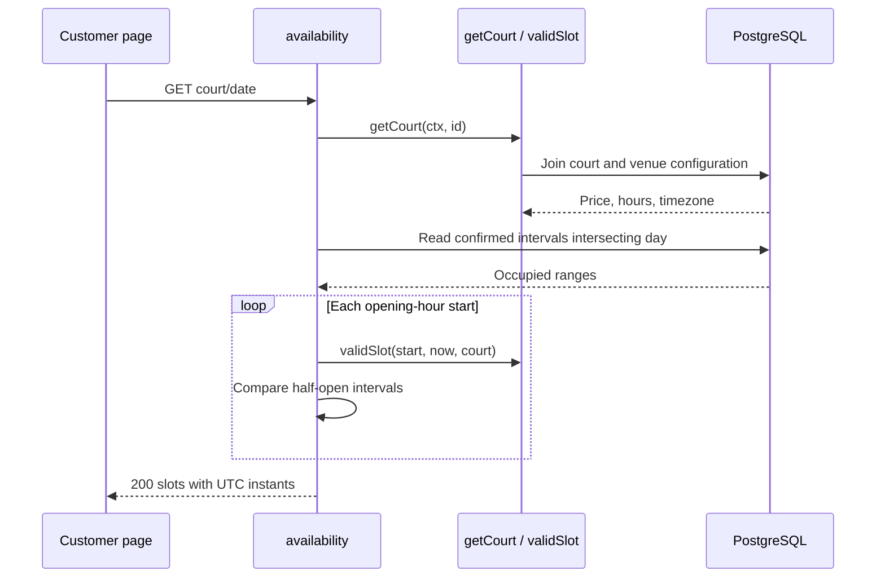

# Finding available sessions

Verified against repository source at `fecc983`; this is a description of the current implementation.

## Business purpose

A guest chooses a court and a playing date. This flow returns the venue’s hourly sessions, their configured price and whether each can currently be booked. Unavailable sessions remain in the response so the interface can show occupancy instead of hiding times.

## API endpoint or triggering event

`GET /api/v1/courts/{id}/availability?date=YYYY-MM-DD`. Home requests it on initial load, on court/date changes and on refresh. There is no identity or authentication requirement.

## Request and response

id is a positive integer court identifier. date is a calendar date in the venue timezone, not a UTC date. A successful 200 response is an array such as `[{"start_at":"2026-11-02T02:00:00Z","end_at":"2026-11-02T03:00:00Z","available":true,"price_sen":2500}]`. The example describes 10–11 am in Kuala Lumpur; whether it is eligible depends on the server clock. Use a date within the current horizon when making a local request.

## Ordered function call flow

1. Handler applies the shared HTTP boundary and dispatches to `API.availability`.
2. availability parses the path ID with strconv.Atoi and rejects nonpositive values.
3. `getCourt(request.Context(),id)` joins courts to facilities to obtain price, opening hour, closing hour and timezone.
4. `time.LoadLocation(c.Zone)` resolves the venue clock. ParseInLocation parses date at local midnight. The handler computes today in that same location and admits today through today.AddDate(0,0,30), inclusive.
5. DB.Query reads confirmed intervals intersecting the selected local day. The handler scans each pair into occupied and checks iterator errors.
6. For each hour from Open through Close-1, it constructs start as day plus that many hours, and end as start plus one hour. validSlot supplies time eligibility. The overlap loop can then mark the session unavailable.
7. JSON writes all sessions, with start/end explicitly converted to UTC.

## Functions and responsibilities

`availability(writer,request)` orchestrates parsing, reads and response construction. `getCourt(ctx,id) (court,error)` in slots.go returns a configuration value; missing rows propagate as pgx.ErrNoRows. `validSlot(start,now,court) bool` loads the configured timezone, checks future/horizon boundaries and requires zero minutes, seconds and nanoseconds plus an opening-hour start. It never queries occupancy. The local occupied slice stores [start,end] pairs used by the handler’s overlap calculation.

## Business rules and validation

The seed opens at 08:00 and closes at 23:00 in Asia/Kuala_Lumpur, so the last start is 22:00. A start must be strictly later than now and no later than now.AddDate(0,0,30). The date-level and instant-level limits differ: day 30 may be accepted while later sessions on that day are unavailable. Already elapsed sessions today are also returned as unavailable. This code constructs sessions with duration addition and is appropriate to the seeded non-DST venue; it does not establish support for arbitrary daylight-saving transition schedules.

## Database queries and transactions

The configuration query selects c.price_sen, f.opens, f.closes and f.timezone from courts joined to facilities by facility_id, with c.id=$1. Occupancy SQL is:

```sql
SELECT start_at,end_at FROM bookings
WHERE court_id=$1 AND status='confirmed'
  AND start_at < $3 AND end_at > $2;
```

$1 is the court ID, $2 the selected midnight and $3 the next local midnight. These are two separate reads with no explicit transaction, locks or writes. The strict comparisons include intervals crossing midnight but exclude ones merely touching a boundary.

## Error handling and edge cases

400 covers an invalid court ID or invalid/missing/out-of-range date. 404 means getCourt found no court. A configuration/occupancy query failure or iterator failure produces 503; scan failure produces 500. An invalid stored timezone returns 500 here. Errors use the shared JSON error shape. Date parsing occurs after the court lookup, so a missing court can be reported before a malformed date.

## Concurrency and consistency

For a candidate [s,e) and stored [bStart,bEnd), overlap means s < bEnd and e > bStart. Adjacent sessions therefore do not overlap. Reads do not reserve anything, and the separate statements need not share a single snapshot. Another guest can book immediately after this response. The booking exclusion constraint, described in booking.md, resolves that later contention.

## Source-file references

`backend/internal/api/availability.go`, `slots.go`, `api.go`, `api_test.go`, `backend/migrations/001_initial.sql`, `frontend/app/page.tsx`.

## Specific coverage and limitations

TestIntegration checks that seeded availability returns 200. TestSlotValidation checks selected future, fractional-hour, past, closed-hour and beyond-horizon starts using a fixed clock. The integration booking assertions cover adjacent intervals, but there is no dedicated assertion of every availability response field or the full day-30 boundary. These gaps must not be mistaken for passing tests.

## Shared HTTP boundary

`backend/cmd/server/main.go:main` creates the pgx pool and passes it to an `api.API`.
The pool allows at most eight connections per process. Its owner is main, which
closes it on exit. Creating the pool is not a database readiness check. The HTTP
server listens on PORT (8080 by default), with header/read/write/idle timeouts of
5/10/10/60 seconds and an 8192-byte maximum header size.

`backend/internal/api/api.go:Handler` registers the routes in Go's ServeMux. Its
wrapper sets Cache-Control: no-store and X-Content-Type-Options: nosniff. A supplied
Origin must exactly match API.Origins or the wrapper returns 403. Requests without
Origin remain allowed; this is browser-origin filtering, not authentication.
OPTIONS requests receive 204 with allowed methods and Content-Type in the allowed
headers. Other requests receive a five-second context deadline that handlers pass
to pgx. This cancels database work; it is separate from transport timeouts.

`JSON(writer,status,value)` sets application/json, writes the status, and encodes
value. `fail(writer,status,message)` uses it to return `{"error":"message"}`.
Database internals are not sent to clients. Encoding/write errors are ignored once
the status is committed. Unknown routes/methods use ServeMux's default responses.

## Tests validating the flow

Run `make test` from the repository root. It supplies the loopback TEST_DATABASE_URL
and runs `go test -race ./...` in backend. `TestIntegration` in
`backend/internal/api/api_test.go` creates a unique schema, applies the migration
twice, invokes handlers through httptest and drops that schema afterward. It uses
real PostgreSQL but does not open a real HTTP listener. Never supply a production
connection. Previous local runs passed; this documentation rewrite does not claim
a fresh test run. Coverage details and gaps specific to this flow follow below.

## Sequence diagram


