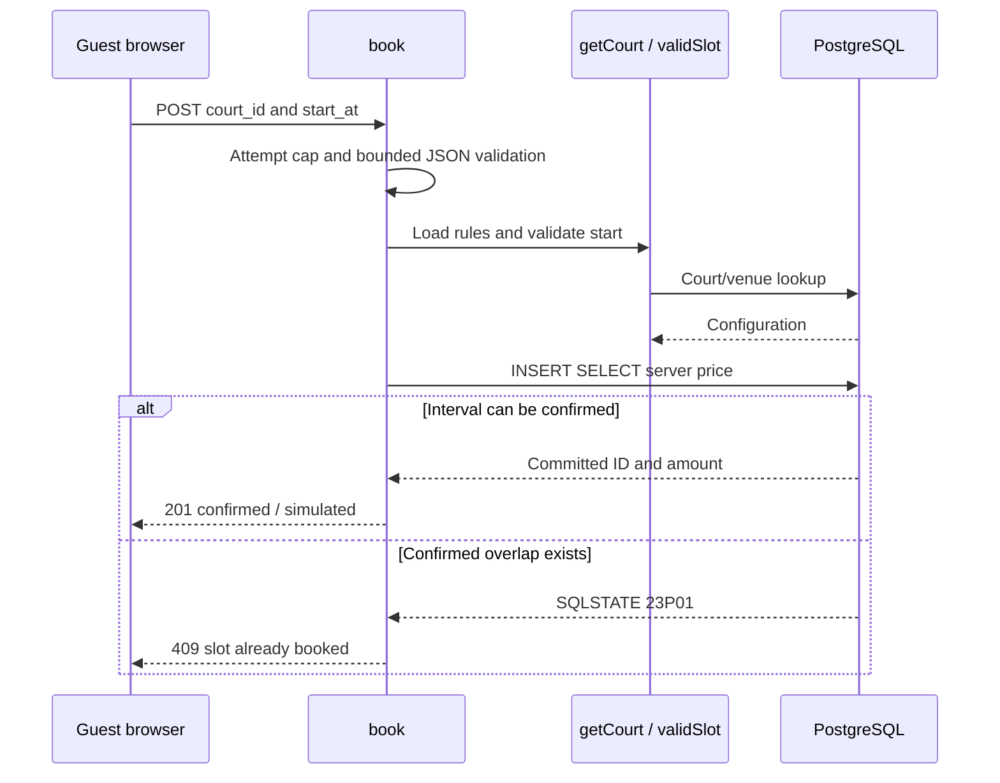

# Confirming a guest demo booking

Verified against repository source at `fecc983`; this is a description of the current implementation.

## Business purpose

A guest confirms one court for one hour without entering personal details or making a payment. A successful request creates a durable confirmed database row immediately. There is no intermediate payment hold or expiry worker.

## API endpoint or triggering event

`POST /api/v1/bookings` is called by Home.book after a guest selects a session. It is public and accepts only the court identifier and start instant.

## Request and response

Content-Type must equal `application/json` exactly. Example body: `{"court_id":1,"start_at":"2026-11-02T02:00:00Z"}`; choose a future whole-hour instant within the horizon for an actual local call. start_at is decoded by Go time.Time from an RFC3339 timestamp. Success is 201 with id (UUID string), court_id (integer), start_at/end_at (UTC strings), amount_sen (integer), status="confirmed" and payment="simulated". A representative error is HTTP 409 with `{"error":"slot already booked"}`. The response payment field is a label, not a recorded payment transaction.

## Ordered function call flow

1. The Handler wrapper applies origin policy and the request deadline, then routes to API.book.
2. book locks the API counter, resets its window after more than a minute, increments attempts and unlocks. Above 120 it returns 429 before body parsing.
3. It checks exact Content-Type, wraps the body with MaxBytesReader at 1024 bytes and creates a JSON decoder that disallows unknown fields. The first decode must succeed, a second decode must produce io.EOF, and CourtID must be positive.
4. getCourt(ctx,CourtID) loads current venue/court rules. pgx.ErrNoRows becomes 404.
5. validSlot(Start,time.Now(),court) verifies time eligibility. Failure becomes 400.
6. DB.QueryRow executes INSERT SELECT with bound court/start/end values and scans the generated ID and actual amount. There is no preceding occupancy read.
7. errors.As inspects a PgError: SQLSTATE 23P01 becomes 409. Other database errors become 503. Success calls JSON with the 201 confirmation.

## Functions and responsibilities

`book(writer,request)` owns HTTP orchestration and error mapping. `getCourt(ctx,id)` returns price/opening schedule/timezone or an error; `validSlot(start,now,court)` returns a boolean and does not reserve a session. pgx QueryRow/Scan executes the database operation and obtains its result. The shared fail/JSON helpers serialize public messages. The mutex is held only while updating the attempt counter, never during SQL.

## Business rules and validation

Each confirmed reservation lasts one hour. The server accepts a strictly future, whole-hour start inside venue opening hours and no later than now.AddDate(0,0,30). The seeded venue uses Kuala Lumpur time and RM25/hour. Client prices, status and duration are not accepted fields. Unknown/trailing JSON, invalid timestamps and nonpositive IDs return 400. An empty/omitted timestamp decodes to a zero time and subsequently fails eligibility. Invalid stored timezone also makes validSlot false and yields 400 in this handler, unlike availability’s explicit 500 path.

## Database queries and transactions

```sql
INSERT INTO bookings(court_id,start_at,end_at,amount_sen)
SELECT id,$2,$3,price_sen FROM courts WHERE id=$1
RETURNING id,amount_sen;
```

$1 is CourtID, $2 Start and $3 Start.Add(time.Hour). Price is read by the INSERT itself, not trusted from the browser or copied from the earlier configuration read. The statement is an implicit atomic transaction. Schema defaults generate the UUID, confirmed status and created_at timestamp. A CHECK enforces exactly one hour; positive amount and foreign-key checks protect row integrity. The earlier court lookup is a separate statement. There is no application transaction spanning configuration lookup and insertion.

## Error handling and edge cases

429 includes Retry-After: 60; this is a conservative retry hint rather than an exact remaining-window calculation. 415 means Content-Type differs from application/json, including an added charset parameter. 400 covers invalid input or slot; 404 a missing court; 409 an occupied interval; 503 lookup/insert failure. A court removed between lookup and INSERT produces no returned row and takes the generic 503 path. Public errors hide driver details. The insert may commit before the browser receives its response: a network error does not imply rollback, and retry can return conflict. There is no idempotency key or authenticated booking lookup.

## Concurrency and consistency

The migration defines a GiST exclusion constraint combining court_id equality with overlap of tstzrange(start_at,end_at,'[)'), restricted to confirmed rows. btree_gist supplies equality support for the court ID. PostgreSQL prevents two overlapping confirmed reservations on the same court even across API processes. Identical eligible requests racing together can yield one commit and conflict responses for others; infrastructure failures can still produce other outcomes. Adjacent intervals and different courts are allowed. The application mutex only limits attempts within one API instance and resets on restart; it is not the reservation lock. Opening rules are checked before the INSERT and are not protected against hypothetical concurrent configuration edits.

## Source-file references

`backend/internal/api/booking.go`, `slots.go`, `api.go`, `api_test.go`, `backend/migrations/001_initial.sql`, and `frontend/app/page.tsx:book`.

## Specific coverage and limitations

TestIntegration launches 24 same-slot requests, asserts one 201 and 23 conflicts, then asserts one stored court-1 row. It checks adjacent/different-court success, malformed time, unknown price field, fractional hour, beyond-horizon, closed-hour and empty-body requests. It directly sets the limiter at its cap and checks 429. It does not simulate a lost response, process-to-process contention or all database failures. Exactly-once delivery is not claimed.

## Shared HTTP boundary

`backend/cmd/server/main.go:main` creates the pgx pool and passes it to an `api.API`.
The pool allows at most eight connections per process. Its owner is main, which
closes it on exit. Creating the pool is not a database readiness check. The HTTP
server listens on PORT (8080 by default), with header/read/write/idle timeouts of
5/10/10/60 seconds and an 8192-byte maximum header size.

`backend/internal/api/api.go:Handler` registers the routes in Go's ServeMux. Its
wrapper sets Cache-Control: no-store and X-Content-Type-Options: nosniff. A supplied
Origin must exactly match API.Origins or the wrapper returns 403. Requests without
Origin remain allowed; this is browser-origin filtering, not authentication.
OPTIONS requests receive 204 with allowed methods and Content-Type in the allowed
headers. Other requests receive a five-second context deadline that handlers pass
to pgx. This cancels database work; it is separate from transport timeouts.

`JSON(writer,status,value)` sets application/json, writes the status, and encodes
value. `fail(writer,status,message)` uses it to return `{"error":"message"}`.
Database internals are not sent to clients. Encoding/write errors are ignored once
the status is committed. Unknown routes/methods use ServeMux's default responses.

## Tests validating the flow

Run `make test` from the repository root. It supplies the loopback TEST_DATABASE_URL
and runs `go test -race ./...` in backend. `TestIntegration` in
`backend/internal/api/api_test.go` creates a unique schema, applies the migration
twice, invokes handlers through httptest and drops that schema afterward. It uses
real PostgreSQL but does not open a real HTTP listener. Never supply a production
connection. Previous local runs passed; this documentation rewrite does not claim
a fresh test run. Coverage details and gaps specific to this flow follow below.

## Sequence diagram


