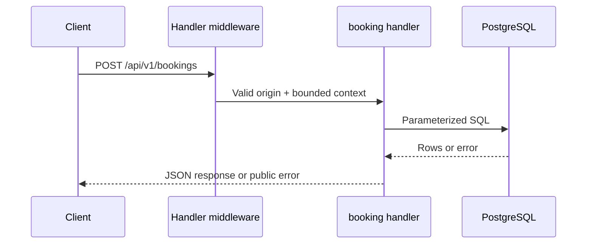

# Booking flow

## Business purpose
Immediately confirm a fictional guest reservation with simulated payment and no personal information.

## API endpoint or triggering event
`POST /api/v1/bookings`. Public fictional demo; no authentication or private user records.

## Request and response
Content-Type must equal application/json. Body: `{ "court_id": 1, "start_at": "RFC3339 instant" }`. Returns 201 with id, court_id, start_at, end_at, amount_sen, status=confirmed and payment=simulated. Unknown fields, including client prices, are rejected.

```bash
curl -i http://localhost:8080/api/v1/bookings -H "Content-Type: application/json" -d '{"court_id":1,"start_at":"REPLACE_WITH_FUTURE_RFC3339_HOUR"}'
```

## Complete ordered function call flow
1. `cmd/server/main.go:main` creates a bounded eight-connection pgx pool and passes it to `API`.
2. `internal/api/api.go:Handler` applies no-store/nosniff headers, validates a supplied Origin against the configured allowlist, answers preflight, and attaches a five-second context deadline.
3. Route-specific chain: `Handler → book → rate-limit mutex → JSON decoder → getCourt → validSlot → pgxpool.QueryRow INSERT RETURNING → JSON`.
4. `JSON` writes the response, or `fail` wraps a stable public error string as `{"error":"..."}`. Database details are not returned.

## Functions, parameters and returns
book takes the request/writer, counts a booking attempt in a process-wide minute window, decodes at most 1024 bytes and rejects trailing JSON. getCourt returns the configuration used by validSlot. The insert reads price_sen from courts in the same statement and returns the generated UUID and actual amount. No user-supplied amount is accepted.
All database operations receive the request context. Handler functions return through HTTP rather than Go return values. `fail(writer,status,message)` and `JSON(writer,status,value)` are shared response helpers.

## Business rules and validation
The seeded facility is CourtFlow Demo Badminton with courts A–D at RM25/hour, opening 08:00–23:00 MYT. Time is stored as timestamptz. One-hour intervals are half-open. Booking starts must be strictly in the future and no more than 30 rolling days ahead. These constraints are checked for writes, and availability uses the same slot predicate.

## Database queries and transactions
INSERT INTO bookings(court_id,start_at,end_at,amount_sen) SELECT id,$2,$3,price_sen FROM courts WHERE id=$1 RETURNING id,amount_sen. Each insert is an implicit atomic transaction. The GiST exclusion constraint over court_id and tstzrange(start_at,end_at,'[)') for confirmed rows is the concurrency authority.

## Error handling and edge cases
400 malformed JSON, unknown fields, invalid times, out-of-hours or horizon; 404 missing court; 415 wrong content type; 429 after 120 attempts per process per minute; 409 SQLSTATE 23P01; 503 other database errors. A lost response may follow a committed insert: retry can return conflict; this is not exactly-once delivery.
Origin policy is browser-origin filtering, not authentication: clients without Origin remain allowed. Unknown routes/methods use Go ServeMux defaults, which are plain-text errors. A request deadline bounds SQL work; server read/write timeouts bound transport work.

## Concurrency and consistency considerations
PostgreSQL arbitrates overlapping concurrent inserts, including across multiple API processes. Exactly one of simultaneous identical-slot inserts can commit; losers receive 23P01 mapped to 409. Adjacent intervals and different courts can commit. The application mutex protects only the abuse counter, not booking correctness. Price changes racing with booking are resolved by the price read in the INSERT statement. Opening-hour configuration has no public mutation API.

## Mermaid sequence diagram


## Relevant source-file references
- `backend/cmd/server/main.go`
- `backend/internal/api/api.go`
- `backend/migrations/001_initial.sql`
- `backend/internal/api/api_test.go`

## Tests validating the flow
`make test` runs Go race-enabled tests against loopback PostgreSQL. `TestIntegration` creates a unique schema, applies migration twice, checks all five routes, submits 24 concurrent identical bookings (one 201, 23 conflicts), verifies row count, adjacent/different-court success, invalid input rejection, CORS and rate limiting. `TestSlotValidation` checks temporal boundaries. Schema cleanup occurs after the test. These passed locally on 2026-10-31. No production requests were made.

## Limits and follow-up
The demo rate limit is global per process, resets on restart and can deny legitimate traffic during abuse. It is a basic bound, not distributed abuse prevention. There is no cancellation, identity, payment, private booking lookup or operations mutation API. No holds or expiry are advertised.
