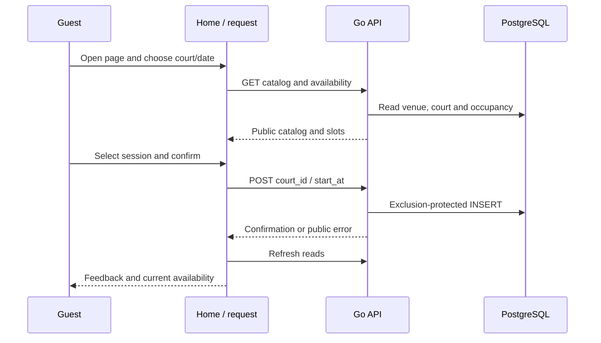

# Customer booking interface

Verified against repository source at `fecc983`; this is a description of the current implementation.

## Business purpose

This is the complete browser journey from opening the demo to receiving a simulated reservation. The guest selects a venue-local date, court and one-hour session. There are no personal-information or payment inputs. Read this document first for the user journey, then follow the linked endpoint documents for server enforcement.

## API endpoint or triggering event

Opening `/` renders Layout and Home. Two React effects start discovery and availability independently. Court/date changes reload availability; Refresh and booking completion increment a refresh counter that reruns both effects.

## Request and response

`request(path,options)` calls fetch at NEXT_PUBLIC_API_BASE_URL, defaulting to http://localhost:8080. It decodes response.json and throws data.error or "Request failed" on non-2xx status. Caller cancellation is combined with a 15-second timeout using AbortSignal.any. JSON parse and network errors also reject. Discovery GETs facilities then facility 1 courts; availability GETs the selected court/date; booking POSTs application/json containing only court_id/start_at. Response shapes and status codes are in facilities.md, courts.md, availability.md and booking.md.

## Ordered function call flow

1. `frontend/app/layout.tsx:Layout({children})` supplies HTML language, metadata and global CSS.
2. `frontend/app/page.tsx:Home()` initializes today/lastDay/date from the Kuala Lumpur calendar, court ID 1, empty collections and loading state.
3. The discovery effect creates an AbortController, calls request for facilities, displays the first name if present, then requests courts for fixed facility 1. Cleanup aborts the requests when refresh changes or the component unmounts.
4. Independently, the availability effect requests the current court/date. Success stores slots; errors are displayed unless cancellation caused them; finally clears loading unless canceled. Cleanup aborts obsolete work.
5. Choosing a date/court clears selection, old slots, notices and errors and sets loading. Choosing an available session stores its full returned Slot.
6. Home.book returns immediately without a selection; otherwise it sets pending, clears old feedback and POSTs the selected start with court ID. Pending disables selection and confirmation controls.
7. Success formats the returned amount/reference into notice and calls reload. reload clears error/selection/slots, enables loading and increments refresh, but deliberately preserves the success notice.
8. Failure stores an error, clears selection/slots and triggers refresh while retaining that error. finally clears pending. Subsequent effects fetch current occupancy.

## Functions and responsibilities

`localDate(Date)` formats a date as YYYY-MM-DD in Asia/Kuala_Lumpur. `hour(timestamp)` formats an instant as a venue-local hour label; `money(sen)` divides integer sen by 100 and formats MYR. `request` returns decoded JSON or a rejected promise; there is no runtime schema validation of response fields. `Home` returns the interactive React tree and owns state/effects. `book` is the asynchronous write action; `reload` changes state to initiate reads. Layout supplies the outer document; globals.css supplies responsive layout and focus/error/success styling.

## Business rules and validation

The date input spans today through 30 days ahead. Unavailable sessions and pending controls are disabled; confirmation additionally requires selection and non-loading state. These checks guide the guest but cannot enforce booking integrity. The server validates again and calculates price. today and lastDay are captured at mount, so a page left open across midnight does not automatically update its date bounds. The discovery flow uses the first facility name but hard-codes facility 1 for courts, reflecting the single-venue demo scope.

## Database queries and transactions

The browser never talks to PostgreSQL. GET responses are advisory snapshots. Only POST booking creates a row, through the Go handler and database exclusion constraint. A successful POST is followed by reads, not a second transaction controlled by React.

## Error handling and edge cases

A conflict is displayed using the server message and refreshes occupancy. JSON parse errors, timeouts and network errors also become feedback. Error text is an aria alert, notices/loading use status/live regions. A network failure can follow a committed booking; refreshing is safer than assuming no booking exists. Cancellation is wired to obsolete effects and suppresses canceled error/finally updates, but success callbacks do not explicitly recheck signal.aborted; there is no separate response-generation guard. The two independent effects share one error state, so failure feedback is not separately tracked per request.

## Concurrency and consistency

pending prevents normal UI duplicate clicks and selection changes while a write is outstanding. It provides no protection against another browser or direct HTTP requests; the database provides that protection. Selection is discarded on refresh to avoid submitting a stale session accidentally. There are no WebSockets, periodic polling, idempotency keys or client-side reservation holds.

## Sequence and source-file references

See `frontend/app/page.tsx`, `layout.tsx`, `globals.css`, `frontend/tests/booking.spec.ts` and `frontend/playwright.config.ts`. The diagram below includes the cross-component write path; backend details live in booking.md.

## Tests validating the flow

Run `cd frontend && npm test` for Playwright. Four outcome cases mock HTTP responses for success, conflict, invalid input and network failure; they check the pending button and confirmation/error feedback. A fifth test checks a 390px viewport for overflow and captures a mobile screenshot. The success mock does not update occupancy, so it does not prove a slot becomes unavailable in a real database. Run npm run lint, npm run typecheck and npm run build for static/build checks. Historical runs passed; this documentation-only revision did not rerun them. Real database behavior is covered separately by backend integration tests and the recorded approved deployment smoke in BUILD_LOG.

## Sequence diagram

