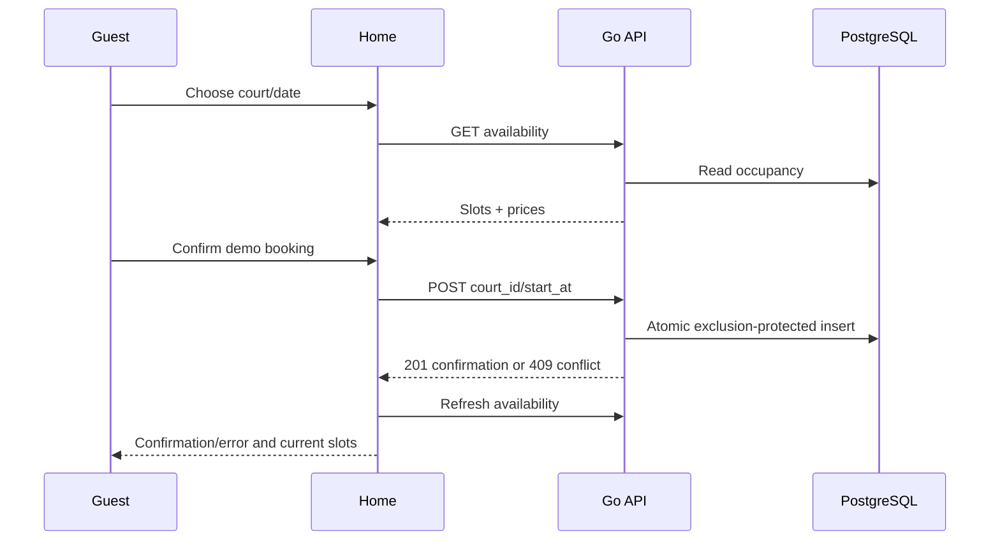

# Customer booking interface

## Business purpose
Let a guest choose a fictional court and local date, review a one-hour price and
receive a simulated confirmation without entering personal or payment information.

## Triggering event and request/response
Opening `/` triggers facilities, court and availability GET requests. Selecting a
date/court reloads availability. Confirm sends only court_id and start_at to POST
/api/v1/bookings. Response schemas are documented in the corresponding API files.

## Ordered function call flow
1. `app/layout.tsx:Layout` wraps children with language, metadata and global CSS.
2. `app/page.tsx:Home` initializes selection, date boundaries and loading state.
3. The discovery effect calls `request` for facilities, then courts. It displays
   the first venue name and the fixed demo facility 1's courts.
4. The availability effect calls `request` with the selected court/date. Cleanup
   aborts obsolete fetches when the selection changes or the component unmounts.
5. Clicking a slot stores its server-supplied interval/price. `hour` formats UTC
   instants as Kuala Lumpur time; `money` formats integer sen as MYR.
6. `book` disables confirmation while pending, POSTs the chosen court/start and
   displays the server-returned amount/reference. `reload` clears stale selection
   and triggers fresh availability. Errors also refresh availability while retaining
   the public error message. A network failure does not imply the insert failed;
   users should refresh before retrying.

## Functions, parameters and return values
`request(path,options)` returns decoded response JSON or throws on HTTP/network
failure. It combines caller cancellation with a 15-second timeout. `localDate(Date)`
returns a venue calendar date. `hour(string)` returns a local time label.
`money(number)` returns formatted currency. `Home()` and `Layout({children})`
return React elements. `book()` returns a promise; `reload()` updates state.

## Rules and validation
Date controls span today through 30 days ahead, unavailable slots are disabled,
and confirmation requires a selection. These are usability checks; all enforcement
and final price calculation are on the server. No PII fields or real payment action
exist. Loading, errors and confirmation use live regions. The layout adapts to mobile.

## Database queries and transactions
The browser never connects to PostgreSQL. API reads are advisory; POST commits the
reservation through the database exclusion constraint. See booking.md and
availability.md for SQL, errors and transaction boundaries.

## Errors, edge cases, concurrency and consistency
A 409 displays the server conflict and refreshes occupancy. Invalid requests and
network failures display actionable errors. Switching dates/courts discards previous
selection. Pending confirmation disables selection changes. Aborted obsolete reads
cannot update state. A successful response can coexist briefly with refresh loading.
The frontend does not implement idempotency, payment holds or realtime updates.

## Sequence diagram

## Source references and tests
`frontend/app/page.tsx`, `layout.tsx`, `globals.css`, `frontend/tests/booking.spec.ts`.
Playwright exercises pending, success, conflict, invalid and network states with
mock API responses, plus a 390px mobile overflow check. These tests complement the
real PostgreSQL backend integration suite; mocked tests do not prove network wiring.
Run `npm test`, `npm run lint`, `npm run typecheck`, `npm run build` in frontend.
