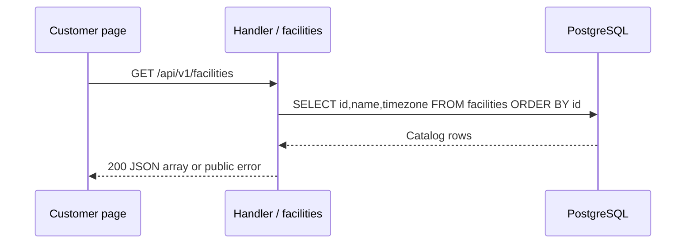

# Facilities catalog flow

Verified against repository source at `fecc983`; this is a description of the current implementation.

## Business purpose

The customer page needs the public venue name and timezone so a guest knows where the sessions take place. This read does not create reservations or expose guest information.

## API endpoint or triggering event

`GET /api/v1/facilities`. Home calls this during discovery and again after refresh. The endpoint is public.

## Request and response

There are no request parameters or body. A successful response is HTTP 200, for example `[{"id":1,"name":"CourtFlow Demo Badminton","timezone":"Asia/Kuala_Lumpur"}]`. An empty result is [] rather than null.

## Ordered function call flow

1. The shared Handler wrapper checks headers/origin and adds the request context deadline.
2. ServeMux invokes `API.facilities(writer,request)` in `backend/internal/api/catalog.go`.
3. The handler requires no input parsing.
4. `DB.Query(request.Context(), SQL) obtains a row iterator.
5. `rows.Next` and `rows.Scan` copy each row into local values and append its public fields to a response map. A deferred Close releases the iterator.
6. The handler checks `rows.Err` before calling `JSON` with the complete list. No partial successful list is returned after a read failure.

## Functions and responsibilities

`facilities` is an HTTP handler: its inputs are http.ResponseWriter and *http.Request and it returns through the HTTP response, not a Go result. `DB.Query` returns rows/error; Scan populates the response fields. JSON and fail own response serialization, as explained below.

## Business rules and validation

Facilities are ordered by their numeric IDs. The endpoint returns stored timezone names without attempting timezone conversion or validation. The current customer page displays the first returned venue name but uses facility ID 1 when loading courts.

## Database queries and transactions

```sql
SELECT id,name,timezone FROM facilities ORDER BY id;
```

This is one read statement with no explicit transaction or writes. No parameter values are interpolated into the query.

## Error handling and edge cases

Query failures return 503 "database unavailable". Scan failures return 500 "read failed"; iterator failures return 503 "read failed". A client may retry a transient failure. An empty catalog is a successful result rather than a database error.

## Concurrency and consistency

The query provides a database statement snapshot. It takes no application mutex and makes no reservation. A later catalog read or booking may see newer configuration; booking computes its own price. No catalog mutation endpoint currently exists.

## Source-file references

`backend/internal/api/catalog.go`, `backend/internal/api/api.go`, `backend/cmd/server/main.go`, `backend/migrations/001_initial.sql`, and `frontend/app/page.tsx`.

## Specific coverage and limitations

TestIntegration checks HTTP 200 for the seeded facilities route. It does not assert the complete response schema, ordering, empty results, malformed catalog identifiers or injected scan errors. These are verified here by source inspection, not claimed as dedicated regression tests.

## Shared HTTP boundary

`backend/cmd/server/main.go:main` creates the pgx pool and passes it to an `api.API`.
The pool allows at most eight connections per process. Its owner is main, which
closes it on exit. Creating the pool is not a database readiness check. The HTTP
server listens on PORT (8080 by default), with header/read/write/idle timeouts of
5/10/10/60 seconds and an 8192-byte maximum header size.

`backend/internal/api/api.go:Handler` registers the routes in Go's ServeMux. Its
wrapper sets Cache-Control: no-store and X-Content-Type-Options: nosniff. A supplied
Origin must exactly match API.Origins or the wrapper returns 403. Requests without
Origin remain allowed; this is browser-origin filtering, not authentication.
OPTIONS requests receive 204 with allowed methods and Content-Type in the allowed
headers. Other requests receive a five-second context deadline that handlers pass
to pgx. This cancels database work; it is separate from transport timeouts.

`JSON(writer,status,value)` sets application/json, writes the status, and encodes
value. `fail(writer,status,message)` uses it to return `{"error":"message"}`.
Database internals are not sent to clients. Encoding/write errors are ignored once
the status is committed. Unknown routes/methods use ServeMux's default responses.

## Tests validating the flow

Run `make test` from the repository root. It supplies the loopback TEST_DATABASE_URL
and runs `go test -race ./...` in backend. `TestIntegration` in
`backend/internal/api/api_test.go` creates a unique schema, applies the migration
twice, invokes handlers through httptest and drops that schema afterward. It uses
real PostgreSQL but does not open a real HTTP listener. Never supply a production
connection. Previous local runs passed; this documentation rewrite does not claim
a fresh test run. Coverage details and gaps specific to this flow follow below.

## Sequence diagram


