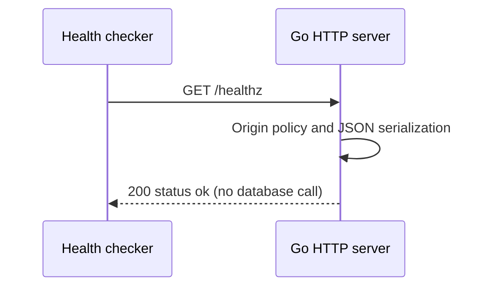

# Health and process lifecycle

Verified against repository source at `fecc983`; this is a description of the current implementation.

## Business purpose

Hosting needs a cheap way to see whether the HTTP process answers requests. GET /healthz reports liveness only. It deliberately makes no database query, so a healthy response cannot prove that bookings will work.

## API endpoint or triggering event

`GET /healthz` is used by the Render health check and local smoke scripts. It passes through the same origin/header wrapper as the API routes.

## Request and response

No body or parameters are required. Success is HTTP 200 with `{"status":"ok"}`. For example, run `curl -i http://localhost:8080/healthz` against the local server.

## Ordered function call flow

1. main reads DATABASE_URL and configures pgx, then creates API with an exact origin allowlist from comma-separated ALLOWED_ORIGINS.
2. API.Handler registers an inline health function and returns the common wrapper.
3. ListenAndServe accepts the request; the wrapper checks Origin and attaches a deadline.
4. The inline function calls JSON with status 200 and the status map. No pgx method is invoked.
5. On SIGINT/SIGTERM, a separate goroutine calls Server.Shutdown with a fresh ten-second context. ListenAndServe returning ErrServerClosed is treated as normal exit.

## Functions and responsibilities

`main()` owns startup and resources. `API.Handler() http.Handler` assembles routing and middleware. The inline health handler takes writer/request and writes its result using JSON. Signal.NotifyContext supplies cancellation for shutdown coordination. main defers pool.Close and the signal stop function.

## Business rules and validation

The endpoint does not inspect migrations, database connections, disk, or external provider availability. The route inherits Origin filtering: an unlisted supplied Origin can receive 403 even when the process is alive.

## Database queries and transactions

None. Pool construction during startup is lazy and is not a Ping. The server never applies schema migrations at startup.

## Error handling and edge cases

Invalid pool configuration or pool setup errors cause main to log a generic message and exit. Unexpected listener failure also exits. Shutdown errors are ignored. The shutdown goroutine requests a graceful drain, but main does not explicitly wait for that goroutine after ListenAndServe returns; the ten-second budget should not be interpreted as a guarantee that every in-flight request completes.

## Concurrency and consistency

The handler uses no mutable health state and does not contend for database connections. It can succeed during a database outage. Transport timeouts and shared wrapper behavior are described below.

## Source-file references

`backend/cmd/server/main.go`, `backend/internal/api/api.go`, `backend/internal/api/api_test.go`, `render.yaml`, `scripts/container-smoke-local.sh`.

## Specific coverage and limitations

TestIntegration checks 200 and rejects an untrusted Origin. The local container smoke checks the JSON status field against a real listener. Shutdown draining and database-down health behavior do not have dedicated automated assertions.

## Shared HTTP boundary

`backend/cmd/server/main.go:main` creates the pgx pool and passes it to an `api.API`.
The pool allows at most eight connections per process. Its owner is main, which
closes it on exit. Creating the pool is not a database readiness check. The HTTP
server listens on PORT (8080 by default), with header/read/write/idle timeouts of
5/10/10/60 seconds and an 8192-byte maximum header size.

`backend/internal/api/api.go:Handler` registers the routes in Go's ServeMux. Its
wrapper sets Cache-Control: no-store and X-Content-Type-Options: nosniff. A supplied
Origin must exactly match API.Origins or the wrapper returns 403. Requests without
Origin remain allowed; this is browser-origin filtering, not authentication.
OPTIONS requests receive 204 with allowed methods and Content-Type in the allowed
headers. Other requests receive a five-second context deadline that handlers pass
to pgx. This cancels database work; it is separate from transport timeouts.

`JSON(writer,status,value)` sets application/json, writes the status, and encodes
value. `fail(writer,status,message)` uses it to return `{"error":"message"}`.
Database internals are not sent to clients. Encoding/write errors are ignored once
the status is committed. Unknown routes/methods use ServeMux's default responses.

## Tests validating the flow

Run `make test` from the repository root. It supplies the loopback TEST_DATABASE_URL
and runs `go test -race ./...` in backend. `TestIntegration` in
`backend/internal/api/api_test.go` creates a unique schema, applies the migration
twice, invokes handlers through httptest and drops that schema afterward. It uses
real PostgreSQL but does not open a real HTTP listener. Never supply a production
connection. Previous local runs passed; this documentation rewrite does not claim
a fresh test run. Coverage details and gaps specific to this flow follow below.

## Sequence diagram

