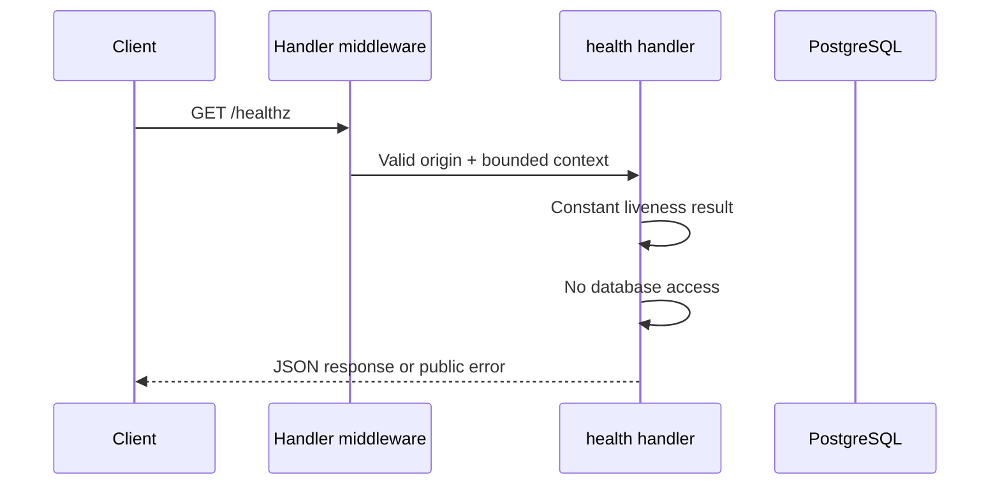

# Health flow

## Business purpose
Check process liveness without a database query. Hosting health checks use this inexpensive endpoint.

## API endpoint or triggering event
`GET /healthz`. Public fictional demo; no authentication or private user records.

## Request and response
No body. Returns 200 with `{"status":"ok"}`. This is liveness, not database readiness.

```bash
curl http://localhost:8080/healthz
```

## Complete ordered function call flow
1. `cmd/server/main.go:main` creates a bounded eight-connection pgx pool and passes it to `API`.
2. `internal/api/api.go:Handler` applies no-store/nosniff headers, validates a supplied Origin against the configured allowlist, answers preflight, and attaches a five-second context deadline.
3. Route-specific chain: `Handler → inline health handler → JSON`.
4. `JSON` writes the response, or `fail` wraps a stable public error string as `{"error":"..."}`. Database details are not returned.

## Functions, parameters and returns
The inline handler takes the response writer and request and emits a constant status. JSON sets content type, writes status and encodes the result.
All database operations receive the request context. Handler functions return through HTTP rather than Go return values. `fail(writer,status,message)` and `JSON(writer,status,value)` are shared response helpers.

## Business rules and validation
The seeded facility is CourtFlow Demo Badminton with courts A–D at RM25/hour, opening 08:00–23:00 MYT. Time is stored as timestamptz. One-hour intervals are half-open. Booking starts must be strictly in the future and no more than 30 rolling days ahead. These constraints are checked for writes, and availability uses the same slot predicate.

## Database queries and transactions
No queries or transactions.

## Error handling and edge cases
A database outage does not change this response. A disallowed Origin is rejected before routing.
Origin policy is browser-origin filtering, not authentication: clients without Origin remain allowed. Unknown routes/methods use Go ServeMux defaults, which are plain-text errors. A request deadline bounds SQL work; server read/write timeouts bound transport work.

## Concurrency and consistency considerations
Reads do not reserve slots. A customer must submit a booking to establish a reservation; the database exclusion constraint remains authoritative. Concurrent writes may change the next read.

## Mermaid sequence diagram


## Relevant source-file references
- `backend/cmd/server/main.go`
- `backend/internal/api/api.go`
- `backend/migrations/001_initial.sql`
- `backend/internal/api/api_test.go`

## Tests validating the flow
`make test` runs Go race-enabled tests against loopback PostgreSQL. `TestIntegration` creates a unique schema, applies migration twice, checks all five routes, submits 24 concurrent identical bookings (one 201, 23 conflicts), verifies row count, adjacent/different-court success, invalid input rejection, CORS and rate limiting. `TestSlotValidation` checks temporal boundaries. Schema cleanup occurs after the test. These passed locally on 2026-10-31. No production requests were made.

## Limits and follow-up
The demo rate limit is global per process, resets on restart and can deny legitimate traffic during abuse. It is a basic bound, not distributed abuse prevention. There is no cancellation, identity, payment, private booking lookup or operations mutation API. No holds or expiry are advertised.
