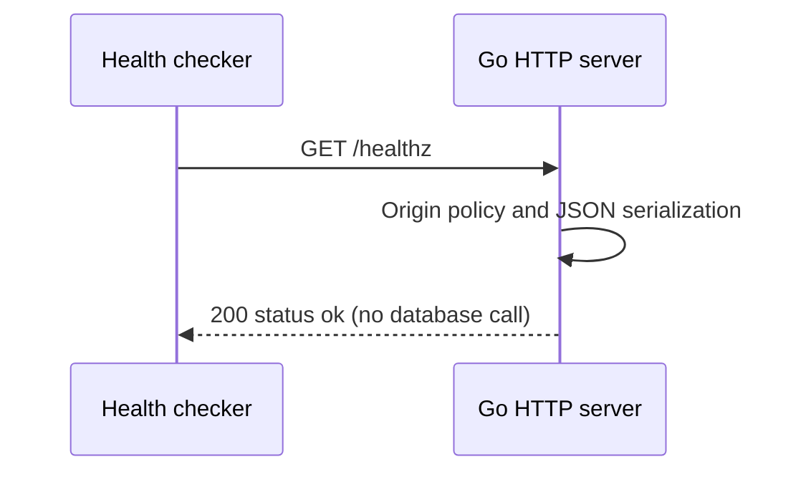
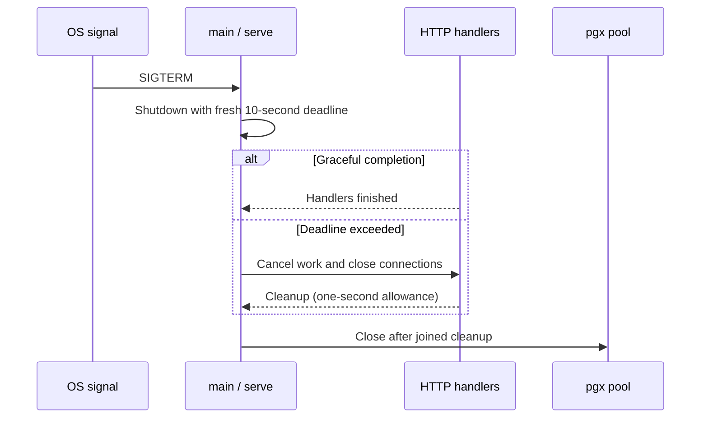

# Health and process lifecycle

Verified against the RELIABILITY-010 working tree, 2026-11-01 MYT. See RELIABILITY_RESULTS.md for fresh checks.

## Business purpose

Hosting needs a cheap way to see whether the HTTP process answers requests. GET /healthz reports liveness only. It deliberately makes no database query, so a healthy response cannot prove that bookings will work.

## API endpoint or triggering event

`GET /healthz` is used by the Render health check and local smoke scripts. It passes through the same origin/header wrapper as the API routes.

## Request and response

No body or parameters are required. Success is HTTP 200 with `{"status":"ok"}`. For example, run `curl -i http://localhost:8080/healthz` against the local server.

## Ordered function call flow

1. main reads DATABASE_URL and configures pgx, then creates API with an exact origin allowlist from comma-separated ALLOWED_ORIGINS.
2. API.Handler registers an inline health function and returns the common wrapper.
3. main creates a TCP listener; serve starts Server.Serve and coordinates its exit with the signal context. The wrapper observes request ID/status, checks Origin and attaches a deadline.
4. The inline function calls JSON with status 200 and the status map. No pgx method is invoked.
5. On SIGINT/SIGTERM, serve calls Shutdown with a fresh ten-second context and waits. Accepted handlers retain their work contexts during graceful drain.
6. On drain expiry, serve cancels work and closes active connections. A mutex gates new handler admission before waiting on the active-handler WaitGroup, preventing Add/Wait races. It allows one additional second for cleanup.
7. Normal completion returns to main, which closes the pool. Unexpected serve/drain errors produce nonzero exit after cleanup. A handler still stuck after forced cleanup returns errHandlersStuck; main logs and exits without blocking on pool.Close.

## Functions and responsibilities

`main()` owns startup and resources. `API.Handler() http.Handler` assembles routing and middleware. The inline health handler takes writer/request and writes its result using JSON. Signal.NotifyContext supplies cancellation for shutdown coordination. main defers the signal stop function; pool.Close is explicit after serve has joined handler cleanup. serve(ctx,srv,listener,drain) returns joined serving/shutdown errors, or errHandlersStuck. Its dedicated work context is independent of the signal context.

## Business rules and validation

The endpoint does not inspect migrations, database connections, disk, or external provider availability. The route inherits Origin filtering: an unlisted supplied Origin can receive 403 even when the process is alive.

## Database queries and transactions

None. Pool construction during startup is lazy and is not a Ping. The server never applies schema migrations at startup.

## Error handling and edge cases

Invalid pool configuration or pool setup errors cause main to log a generic message and exit. Unexpected listener failure also exits. Shutdown errors are returned and logged. Graceful drain is ten seconds; forced cancellation then allows one second for handlers. A permanently stuck handler takes an explicit process-exit path rather than an unbounded pool close. Health is still liveness only.

## Concurrency and consistency

The handler uses no mutable health state and does not contend for database connections. It can succeed during a database outage. Transport timeouts and shared wrapper behavior are described below.

## Source-file references

`backend/cmd/server/main.go`, `lifecycle.go`, `lifecycle_test.go`, `backend/internal/api/diagnostics.go`, `backend/internal/api/api.go`, `backend/internal/api/api_test.go`, `render.yaml`, `scripts/container-smoke-local.sh`.

## Specific coverage and limitations

TestIntegration checks 200 and rejects an untrusted Origin. The local container smoke checks the JSON status field against a real listener. TestServeDrain verifies both completed in-flight response and deadline-triggered cancellation using real loopback HTTP; TestServeListenerFailure verifies startup listener failure. A local process probe sent actual SIGTERM while a booking waited on a court lock, released that lock and verified 201, one row and exit zero. Database-down health is not separately asserted.

## Shared HTTP boundary

`backend/cmd/server/main.go:main` creates the pgx pool and passes it to an `api.API`.
The pool allows at most eight connections per process. Its owner is main, which
closes it on exit. Creating the pool is not a database readiness check. The HTTP
server listens on PORT (8080 by default), with header/read/write/idle timeouts of
5/10/10/60 seconds and an 8192-byte maximum header size.

`backend/internal/api/api.go:Handler` registers the routes in Go's ServeMux. Its
wrapper sets Cache-Control: no-store and X-Content-Type-Options: nosniff. A supplied
Origin must exactly match API.Origins or the wrapper returns 403. Requests without
Origin remain allowed; this is browser-origin filtering, not authentication.
OPTIONS requests receive 204 with allowed methods and Content-Type in the allowed
headers. Other requests receive a five-second context deadline that handlers pass
to pgx. This cancels database work; it is separate from transport timeouts.

`JSON(writer,status,value)` sets application/json, writes the status, and encodes
value. `fail(writer,status,message)` uses it to return `{"error":"message"}`.
Database internals are not sent to clients. Encoding/write errors are ignored once
the status is committed. Unknown routes/methods use ServeMux's default responses.

## Tests validating the flow

Run `make test` from the repository root. It supplies the loopback TEST_DATABASE_URL
and runs `go test -race ./...` in backend. `TestIntegration` in
`backend/internal/api/api_test.go` creates a unique schema, applies the migration
twice, invokes handlers through httptest and drops that schema afterward. It uses
real PostgreSQL but does not open a real HTTP listener. Never supply a production
connection. Fresh uncached race/integration and lifecycle tests passed for RELIABILITY-010. Coverage details and gaps specific to this flow follow below.

## Sequence diagram

## Lifecycle sequence

A stuck-handler fallback terminates the process instead of the final Close step.
Health response remains independent of this coordination and has no DB transaction.

## Limitations and follow-up

No readiness endpoint or DB startup ping added. No backup/recovery changes. The
forced-exit branch bounds handler waiting but cannot guarantee delivery of responses
or graceful completion of code that ignores cancellation. Request logs contain route
patterns, IDs and statuses; status is not acknowledgment by the remote caller.
