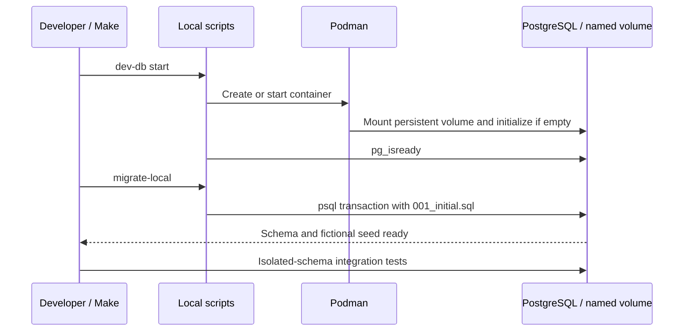

# Local database lifecycle and schema

Verified against repository source at `fecc983`; this is a description of the current implementation.

## Business purpose

Developers need a repeatable PostgreSQL environment that persists across restarts and remains separate from the public demo database. Podman supplies PostgreSQL 17, a named volume stores its data, and versioned SQL defines the application schema. Local tests use isolated schemas rather than production data.

## API endpoint or triggering event

This flow is operated from the shell, not an HTTP endpoint. `make dev-db` starts the container; `make migrate-local` applies the initial schema. main never runs migrations. `scripts/dev-db.sh` also accepts stop, status and psql.

## Request and response

The default container is courtflow-postgres, volume courtflow_pgdata, database/user courtflow, and host binding 127.0.0.1:5433 → container port 5432. COURTFLOW_LOCAL_DB_PASSWORD overrides the documented development-only password at first creation. A typical sequence is `make dev-db`, `make migrate-local`, then `make test`. If the password is overridden, match the Makefile LOCAL_DB_URL override as explained in README. Actual secrets are not committed.

## Ordered function call flow

1. Make invokes dev-db.sh start. require_podman verifies the executable. container_exists and container_running inspect the named container.
2. If absent, the script creates/reuses the named volume and runs postgres:17 with loopback port binding and PostgreSQL initialization variables. If stopped, it starts the existing container. If already running, it reuses it.
3. A readiness loop runs podman exec pg_isready up to 30 times, with one-second waits, and fails on timeout.
4. migrate-local.sh changes to the repository root and streams 001_initial.sql into container psql with ON_ERROR_STOP and --single-transaction. An SQL error stops the command and prevents a partial transaction commit.
5. The migration enables btree_gist, creates tables/constraints if absent and inserts fictional facility/courts with ON CONFLICT DO NOTHING.
6. make test passes a loopback URL to Go tests. TestIntegration creates a unique schema, sets search_path to that schema plus public, runs migration twice, exercises requests and defers schema deletion.

## Functions and responsibilities

`require_podman()` fails when the tool is unavailable. `container_exists()` and `container_running()` supply shell exit-status predicates. The start/stop/status/psql cases perform lifecycle actions. The psql case shifts the subcommand and forwards remaining arguments into an interactive container client. migrate-local.sh executes the versioned SQL; it is not a general migration-version ledger. TestIntegration owns temporary test tables and its pgx pool; production server main owns the application pool.

## Business rules and validation

facilities stores venue name, timezone and integer opening/closing hours with range checks. courts references a facility and stores a positive integer price_sen. bookings references a court, has UUID/default creation time, positive amount, confirmed/cancelled status and start/end timestamptz values. A CHECK requires exactly one hour. Only fictional records are seeded; there are no identities or payment tables. Re-running INSERTs does not update existing configuration.

## Database queries and transactions

The migration creates an exclusion constraint on `(court_id WITH =, tstzrange(start_at,end_at,'[)') WITH &&)` for confirmed rows. btree_gist supplies the scalar equality operator support needed alongside the time range. [start,end) includes the start and excludes the end: adjacent sessions can coexist. Local migration execution is one transaction; application INSERTs use their own implicit transactions. There is no automatic version tracking or rollback command. Later schema changes must be new reviewed migrations, not edits to deployed 001.

## Error handling and edge cases

Missing Podman, readiness timeout, stopped-container psql access and SQL failures fail the command. stop preserves the named volume; deleting/recreating containers alone should not erase that data. Changing initialization environment variables does not reset credentials in an already initialized volume. The start script prints that startup began before finishing readiness checks, so rely on its successful exit. An existing incompatible schema is not repaired by CREATE TABLE IF NOT EXISTS. Concurrent migration runners are not coordinated by this script.

## Concurrency and consistency

The database exclusion constraint protects booking overlap even with multiple clients/processes. The local container and named volume are shared development resources. Tests isolate application tables by schema, but keep public visible for extension reuse; this is not a fully isolated PostgreSQL cluster. The test schema name is derived internally from a timestamp rather than user input.

## Sequence and source-file references

Read `scripts/dev-db.sh`, `scripts/migrate-local.sh`, `Makefile`, `backend/migrations/001_initial.sql`, `backend/internal/api/api_test.go`, `scripts/persistence-local.sh`, and `scripts/container-smoke-local.sh` together. The two smoke scripts create and clean local test bookings; do not point their workflows at production.

## Tests validating the flow

`make test` checks migration repeatability and real constraint contention in temporary schemas. `bash scripts/persistence-local.sh` builds/starts a local API, creates a booking, restarts API/PostgreSQL and verifies the stored row, with cleanup. Its final check is a direct row count and a health request, not a browser flow. Build/run the local image and invoke container-smoke-local.sh as shown in README to verify health and one booking through a real listener. Previous receipts record successful runs. No tests or restarts were performed for this documentation rewrite; this is source verification, not a new runtime receipt.

## Sequence diagram

