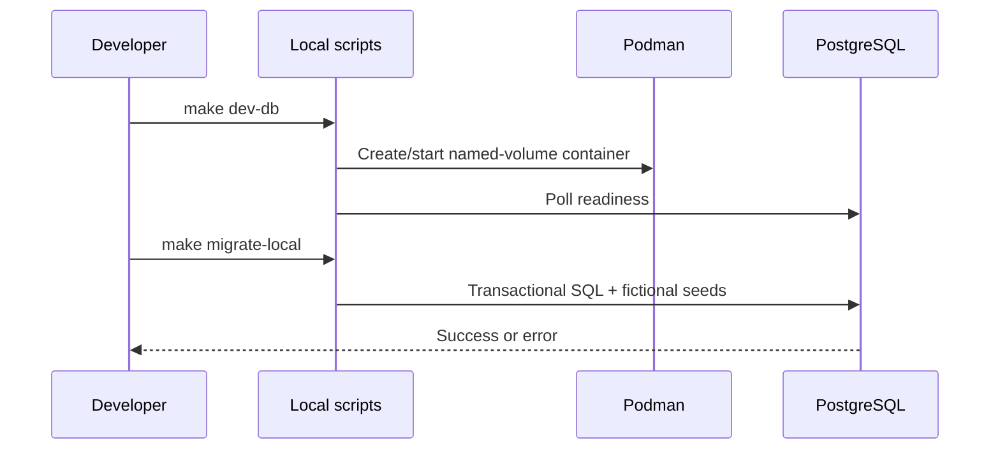

# Local database lifecycle and migration

## Business purpose and trigger
Provide reproducible local-only storage, seed data and isolated correctness tests.
`make dev-db` invokes `scripts/dev-db.sh start`; `make migrate-local` invokes
`scripts/migrate-local.sh`. There is no HTTP endpoint for migration or cleanup.

## Inputs and outputs
Container name courtflow-postgres, named volume courtflow_pgdata, Postgres 17,
loopback host port 5433, database/user courtflow. Optional
COURTFLOW_LOCAL_DB_PASSWORD changes initial creation credentials only; it does not
rotate an existing volume's password. Ready exit is zero; failures are nonzero.

## Ordered call flow and functions
`require_podman` checks executable availability. `container_exists` uses Podman
metadata; `container_running` reads state. Start creates the volume/container only
when absent, otherwise starts a stopped container, then polls pg_isready for up to
30 seconds. Stop preserves the named volume. Status reports readiness. psql opens
an interactive local client inside the container.
`migrate-local.sh` changes to the repository root and feeds migration SQL to
`podman exec -i ... psql --single-transaction -v ON_ERROR_STOP=1`.

## Queries, transactions and rules
001_initial.sql creates btree_gist, facilities, courts and bookings, plus fictional
seed rows. Tables/extension use IF NOT EXISTS, seeds ON CONFLICT DO NOTHING.
The migration is one transaction; SQL errors abort rather than partially applying.
The booking exclusion constraint uses half-open timestamp ranges and only confirmed
rows. Duration and positive amount are also database checks.

## Errors and edge cases
A Podman/pull failure exits nonzero. Readiness timeout fails startup. Existing
containers are reused, so changing image/password variables does not recreate them.
Never delete the volume casually. psql failures preserve diagnostic output.
No automatic schema migration is performed by the API or production container.

## Concurrency and consistency
DDL is a local operator operation, not a runtime booking path. Integration tests use
unique schemas, a loopback-only connection check and cleanup after completion;
they apply the migration twice to validate repeatability. Production credentials
must never be passed to these scripts. SQL inserts enforce booking consistency
independently of application processes.

## Sequence diagram

## Source references and tests
scripts/dev-db.sh, scripts/migrate-local.sh, backend/migrations/001_initial.sql,
backend/internal/api/api_test.go, scripts/persistence-local.sh.
The migration, repeat application, isolated integration suite and API/database
restart persistence check passed locally on 2026-10-31. Persistence script creates
one future court D booking, restarts both services, checks its UUID and removes only
that test record. It requires its fixed future slot to be free.
