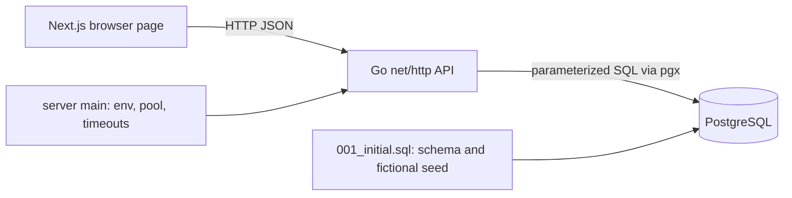

# Reading CourtFlow: repository and system analysis

## Start with the user journey

CourtFlow is a small monolith with a separately hosted browser interface. A guest
chooses a court/date, reads available sessions, then submits one simulated booking.
The browser makes HTTP requests to Go; Go uses pgx to query PostgreSQL. PostgreSQL
is the final authority on overlapping reservations and persisted data.

## Repository map

| Path | Responsibility | How to read it |
| --- | --- | --- |
| `backend/cmd/server/main.go` | Process startup, environment configuration, connection pool, HTTP server and graceful shutdown | Start here to see how dependencies are assembled and owned |
| `backend/internal/api/api.go` | API shared state, routes, CORS, headers, deadlines, JSON/error helpers | Find the URL, then follow its registered handler |
| `backend/internal/api/catalog.go` | Facility and court list handlers and their SQL reads | Learn the simplest request → SQL → JSON path |
| `backend/internal/api/slots.go` | Court configuration lookup and shared booking-slot rules | Read before availability and booking; both use these rules |
| `backend/internal/api/availability.go` | Venue-date parsing, occupied interval reads, available session construction | Understand why display dates use venue time but returned instants use UTC |
| `backend/internal/api/booking.go` | Attempt limit, request validation, server price, atomic insert, conflict response | Read beside the SQL exclusion constraint |
| `backend/internal/api/api_test.go` | Slot validation and isolated PostgreSQL integration/concurrency checks | Read assertions to understand the observable contract |
| `backend/migrations/001_initial.sql` | Tables, keys, constraints and fictional facility/court seed | This is deployed schema history; later changes need a new migration |
| `backend/go.mod`, `go.sum` | Go module/dependency versions and checksums | They define reproducible backend dependencies |
| `frontend/app/layout.tsx` | HTML shell, language, metadata, shared CSS import | Outer wrapper around the page |
| `frontend/app/page.tsx` | Browser request helper, formatting, React state/effects, selection and confirmation UI | Follow Home initialization → effects → selection → book → reload |
| `frontend/app/globals.css` | Visual styles and responsive layout | Read alongside the page's class names |
| `frontend/tests/booking.spec.ts` | Mocked browser success/error/pending/mobile checks | These prove UI behavior, not real database wiring |
| `frontend/playwright.config.ts` | Browser test server and runner configuration | Explains how npm test starts local verification |
| `frontend/package.json`, `package-lock.json` | npm commands and locked dependencies | Use npm ci; avoid concurrent installs/builds |
| `frontend/tsconfig.json`, `eslint.config.mjs`, `next-env.d.ts` | TypeScript, lint and Next.js type integration | next-env is framework-managed |
| `scripts/` | Environment checks, local DB lifecycle/migration, verification, persistence and container smoke | Inspect before executing; persistence/smoke scripts create and clean local test records |
| `Makefile` | Convenient entry points into local scripts and builds | Authoritative quick commands are also listed in README |
| `backend/Dockerfile`, `render.yaml`, `frontend/vercel.json` | Backend image and manual cloud deployment configuration | Read with the production runbook, not as local test commands |
| `.env.example` files | Required configuration names and placeholder values | Actual secrets stay out of Git; Go does not auto-load env files |
| `.agents/skills/`, `AGENTS.md`, `DEVELOPMENT.md`, `WORKFLOW_ADDENDUM.md`, `CODEX_START_HERE.md` | Contributor/agent workflow and review requirements | Current handoff resolves historical setup-only statements |
| `docs/PRODUCTION_RUNBOOK.md` | Release, smoke, retention and rollback procedures | Local changes do not become live on push |
| `buildDocs/buildDocs/CourtFlow/` | Obsidian architecture, flow analysis, build history and handoff | Open buildDocs/buildDocs as the vault; retain its existing location |

## Go conventions and the chosen boundaries

All files under internal/api have `package api`. Go compiles them together: a file
is a navigation aid, not a class or a separate runtime layer. A lowercase function
such as `book` is accessible throughout that package; exported names such as API
and Handler are accessible to main. `internal` prevents unrelated external modules
from importing this implementation. `cmd/server` is the executable entry point.

Methods such as `(a *API) book` operate on the shared API instance. Its pool is safe
for concurrent use. Request-local values stay in function variables. The mutex
protects only the shared attempt counter; it does not make bookings race-safe.
The SQL exclusion constraint provides that guarantee across concurrent processes.

The project uses responsibility-based files, explicit errors, composition and
parameterized SQL. It intentionally retains direct handler-to-pgx calls because
there is one small storage implementation. SOLID is a useful review lens, not a
requirement to add interfaces, constructors and service/repository wrappers around
every function. Introduce such boundaries when actual reuse or substitution needs
justify them. Current response maps are simple but less type-safe than named DTOs;
consider typed responses when the public contract grows.

## How to read every system-analysis document

The documents are in `buildDocs/buildDocs/CourtFlow/system-analysis/`.
Read the business purpose and request/response first. Then follow the numbered
call chain with the source open. At each step ask: what enters, what is validated,
what can fail, what state changes, and what returns to the caller?

Read database/transaction and concurrency sections together. A successful GET is
only a snapshot; another visitor can book before POST. Read error handling next
so the success sequence does not hide 400/409/503 behavior. Finally check tests:
which assertions exercise the rule, which dependencies are mocked, and which
limitations remain? Mermaid diagrams summarize the interaction; source and SQL
supply the details. File paths identify code, while function names identify the
actual operation. There are no hidden service/repository layers in this version.

Recommended complete reading order:

1. `architecture/` and `HANDOFF.md`: understand deployment boundaries, implemented
   scope and current state. Historical appendices may describe earlier releases.
2. `local-database.md`: local container/volume, schema setup, migrations and test
   isolation. Pair it with dev-db.sh, migrate-local.sh and 001_initial.sql.
3. `health.md`: the smallest HTTP flow. Health is process liveness, not a DB probe.
4. `facilities.md` then `courts.md`: catalog reads and JSON responses. Follow
   Handler in api.go into catalog.go, then the corresponding SQL tables.
5. `availability.md`: local date → court configuration → occupied intervals →
   offered one-hour slots. Read slots.go and availability.go together.
6. `booking.md`: body decoding → validation → insert → confirmation/conflict.
   Read booking.go, slots.go, the exclusion constraint and concurrency test together.
7. `customer-booking.md`: connect the entire journey to React effects, cancellation,
   selected session, loading/error states and post-booking refresh. Layout and CSS
   explain presentation; the API documents explain enforcement.
8. `docs/PRODUCTION_RUNBOOK.md` and `BUILD_LOG.md`: distinguish release operations
   and recorded verification from application behavior. No scheduled cleanup or
   real payment system should be inferred from a future-work note.

## Trace one booking across every component

Home loads facilities/courts and requests availability for the selected venue date.
The server looks up court price/opening hours/timezone, queries confirmed intervals,
and returns UTC start/end instants. The browser formats them in Kuala Lumpur time.
On confirmation it sends only court_id and start_at. Middleware checks Origin and
adds a deadline; book applies the attempt cap and bounded JSON decoding. getCourt
and validSlot enforce the booking horizon and opening hours. The INSERT reads price
from courts, and PostgreSQL rejects overlapping confirmed ranges with SQLSTATE
23P01. Go maps that to 409 or returns 201 with the stored amount/reference. Home
shows the result and refreshes availability. The production runtime is Vercel →
Render → Neon; local verification uses Next.js → local Go → Podman PostgreSQL.

## Review and verification

The required cycle now includes implementation → explicit stop Chisle → explanatory comment pass →
readability/code review → affected
local checks → full flow documentation → build log/handoff → reviewed commit.
Use gofmt, Go vet/race/integration tests, frontend lint/typecheck/build and relevant
browser checks. Comments should explain decisions and invariants, especially UTC
versus venue time, half-open ranges, server pricing and concurrency. A green test
suite supports the review; it cannot certify that every future maintenance need
has been anticipated.
